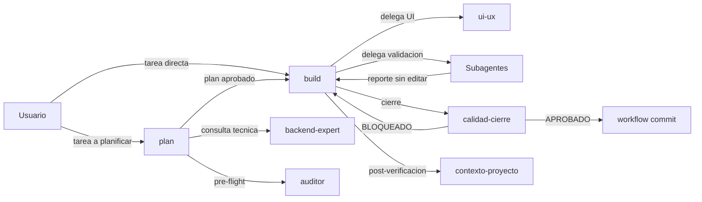

# Pipeline de ejecucion de tareas — OpenCode

> **Fecha:** 2026-09-19 · **Actualizado:** 2026-10-22 (flujo corto; el detalle vive en [pipeline-referencia.md](pipeline-referencia.md)) · **Estado:** vigente · **Para quien:** dev junior con TDAH — leer en 2 min.
> **Estado del harness:** los 2 primarios son `build` y `plan`; `ui-ux` y `backend-expert` son subagents. Inventario vigente en [estado-actual.md](estado-actual.md); topes en [presupuestos.md](presupuestos.md).
> Regla de esta doc: **enlazar, no copiar**. La tabla del Skill Gate vive en `OPENCODE.md`; las referencias usan seccion, no linea.

## 2. Pipeline por actor

Quien hace que, y quien decide cada transicion.

### Fases (detalle en [pipeline-referencia.md](pipeline-referencia.md) §2)

| Fase | Que pasa | Quien |
|---|---|---|
| 1 · Inicia | Abres `build` o `plan` en Tab; los subagentes se lanzan con `@` | Usuario |
| 2 · Planifica | Plan con evidencia del repo; nunca edita; redacta la spec si el cambio es auditable | `plan` |
| 3 · Implementa | Features, bugs y refactors con DoD; delega la UI | `build` (+ `ui-ux`) |
| 4 · Valida | E2E, revision contra skills, refactor/perf y causa raiz | `tester` · `auditor` · `quality` · `debugger` |
| 5 · Cierra | Criterios, cierre del backlog, actualizacion del cerebro y commit propuesto | `calidad-cierre` · `contexto-proyecto` · `workflow` |

El trabajo abierto vive en `docs/features/BACKLOG.md`; `trace.py` crea el expediente y registra la evidencia por criterio (contrato: `documentacion/references/TRACE.md`).

## Ver mas

- Detalle por actor, routing, ciclo de tarea, estados, commit loop, cierre, permisos y fricciones conocidas: [pipeline-referencia.md](pipeline-referencia.md).
- Inventario, topes y changelog: [estado-actual.md](estado-actual.md) · [presupuestos.md](presupuestos.md) · [changelog.md](changelog.md).
